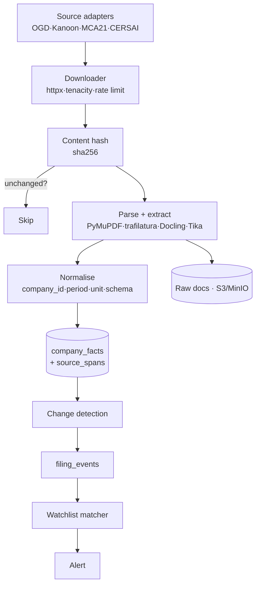
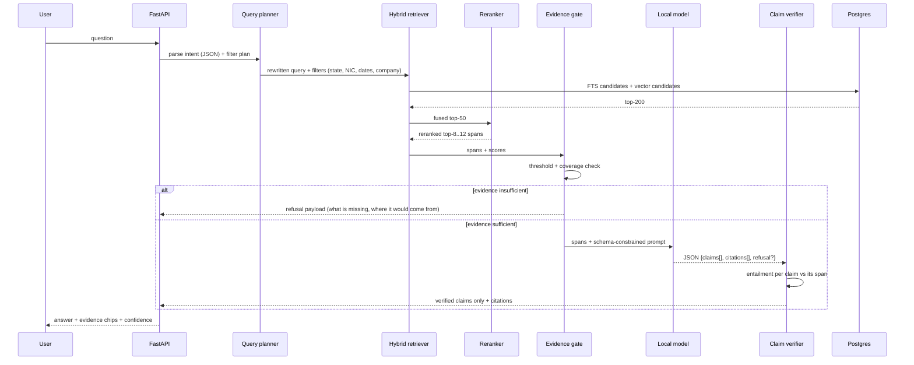

# Private AI Business Intelligence for India — Full Architecture

Companion to `final_turn_001.md` (the market/legal research). This document is the **build spec**:
every layer, every component, every software candidate, and the decision taken at each fork.

Stack convention: `★` = default pick · `○` = acceptable alternative · `✗` = do not use (rejected, with reason).

---

## 0. The spine in one page

The system is six planes. Everything else in this document is detail under one of these.

| Plane | Job | Non-negotiable property |
|---|---|---|
| **Control** | Users, tenants, plans, entitlements, billing, quotas, audit | Every request is tenant-scoped and metered before it reaches the model |
| **Data** | Ingest, normalise, version, cite: the corpus and the facts derived from it | Every fact carries `source_document + locator + retrieved_at` |
| **Intelligence** | Retrieve, rerank, gate, generate, verify claims | Generation sees only retrieved spans and must emit a citation per claim |
| **Trust** | Redaction, isolation, evaluation, privacy compliance | No customer content leaves Indian infrastructure; quality is measured, not claimed |
| **Experience** | Chat, watchlist, briefs, company pages, API, MCP | Every answer shows its evidence; refusal is a designed state, not an error |
| **Operations** | Infra, CI/CD, observability, cost ceiling | A corpus or model change cannot silently degrade quality — CI gates it |

```mermaid
flowchart LR
  subgraph EXP[Experience]
    WEB[Web app<br/>React+Vite] · MCP[MCP server<br/>for consultants] · API[REST API]
  end
  subgraph CTL[Control]
    AUTH[Auth + tenants] · BILL[Billing<br/>Razorpay] · QUOTA[Quota + cost ledger]
  end
  subgraph DATA[Data]
    ING[Ingestion<br/>OGD·MCA·Kanoon] · NORM[Normaliser] · FACT[(Facts + provenance<br/>Postgres)] · SRC[(Raw docs<br/>S3/MinIO)]
  end
  subgraph INT[Intelligence]
    RET[Hybrid retrieval<br/>FTS + pgvector] · RR[Cross-encoder rerank] · GATE[Evidence gate] · GEN[Grounded generation<br/>local model] · VER[Claim verifier]
  end
  subgraph TRU[Trust]
    RED[Redaction gateway<br/>Presidio] · EMB[Local embeddings] · EVAL[Eval harness<br/>promptfoo·RAGAS] · AUD[Audit log]
  end
  WEB --> AUTH --> API --> QUOTA
  API --> RET --> RR --> GATE
  GATE -->|evidence found| GEN --> VER --> API
  GATE -->|weak| REF[Refusal path]
  ING --> NORM --> FACT --> SRC
  FACT --> RET
  RED -.tenant docs only.-> RET
  EVAL -.CI gate.-> GEN
  BILL --> QUOTA
```

### The three decisions everything else follows from

1. **Two corpora, two trust regimes.** The public corpus (OGD, filings, licensed case law) contains no customer data → it needs no gateway and no redaction; run inference in-country and move on. The private corpus (customer documents) is where identity fields are scrubbed and quantities preserved. Never mix them in one retrieval space without the tenant filter.
2. **Grounded-or-refuse, not "zero hallucination".** Generation is a two-stage contract: an evidence gate (is there enough?) and a claim verifier (is each sentence entailed by a span?). A claim that fails verification is deleted, not published.
3. **The evaluation harness is a product surface, not QA.** It ships to customers as a public scorecard and gates CI. It is the only moat in the competitive set that cannot be copied in a sprint.

---

## 1. Layer 1 — Experience (client + surfaces)

### 1.1 Web application

| Concern | Software | Note |
|---|---|---|
| Framework | ★ React 19 + Vite 8 + TypeScript | You already ship this stack in the `gift` repo — reuse the exact toolchain |
| Styling | ★ Tailwind CSS 3 + shadcn/ui | shadcn = copy-in components, no vendor lock-in; Radix primitives under it |
| Routing | ★ React Router 7 | Same as today |
| Server state | ★ TanStack Query | Cache, retries, invalidation for company/filing pages |
| Client state | ★ Zustand 4 | Same as today |
| Charts | ○ Recharts · ★ visx for filing trends | Recharts for speed |
| Forms | ★ react-hook-form + zod | zod schemas shared with the API contract |
| Editor (briefs) | ○ TipTap | Only if briefs become editable |
| Tables | ★ TanStack Table | Company/filing grids with server-side pagination |
| Icons | ★ Lucide (already installed) | |
| i18n | ★ react-i18next | Hindi/English UI; content stays as-is, not translated by the LLM |
| Tests | ★ Vitest + Testing Library + MSW | You already run 359 tests this way — reuse the setup |
| E2E | ★ Playwright | Critical for the watchlist + citation UX |
| Accessibility | axe-core via @axe-core/playwright | Public-sector customers ask |
| Docs site | ★ Docusaurus (public docs + methodology) | The methodology page is a marketing asset |

**Company profile pages are the growth engine, not a side feature.** Every company in the OGD corpus gets a static page (master data + financials + charges + litigation + links). That is programmatic SEO, and it is the acquisition channel your research said content/SEO must be. Build it with the corpus, not separately.

- ★ Astro (islands) for the SEO surface, or Next.js ISR if you want one codebase — but the chat app should stay a separate Vite SPA. Two deploy targets, one monorepo.
- ○ WordPress headless is unnecessary here.

### 1.2 Other surfaces

| Surface | Software | Why |
|---|---|---|
| MCP server | ★ FastMCP (Python) or `@modelcontextprotocol/sdk` (TS) | Expose `search_company`, `get_filings`, `ask_with_citations` to Claude/Cursor. This is how you reach consultants without building a consultant UI |
| REST API | ★ FastAPI + OpenAPI 3.1 | Pydantic v2 request/response models; generated TS client (`openapi-typescript`) |
| Watchlist alerts | ★ Novu (self-hosted) or a simple worker + email | Digests, not real-time pushes |
| Email | ★ Resend / Amazon SES (mumbai) · Postmark | Transactional + brief delivery |
| WhatsApp | ★ WhatsApp Business API via Gupshup / Interakt / Wati | For Indian SMB habit: brief delivered on WhatsApp, not email |
| Push | ○ Firebase Cloud Messaging / OneSignal | Only if the watchlist becomes push-worthy |
| Embed widgets | ★ iframe + snippet | "Ask about this company" for company pages |

---

## 2. Layer 2 — Control plane

### 2.1 Identity and tenancy

| Concern | Software | Note |
|---|---|---|
| Auth | ★ Supabase Auth (Postgres-based, you know it) or Clerk | Supabase keeps one bill and one RLS model. Clerk has better prebuilt UI but a US SaaS dependency for the auth surface (metadata only — acceptable, but Supabase is cleaner for the sovereignty story) |
| Tenancy model | ★ Schema-per-tenant for the private-doc tier; `tenant_id` + RLS for the shared tier | Copy the pattern from your `gift` repo: RLS + `SECURITY DEFINER` functions with `search_path = ''` |
| OTP / phone | ★ MSG91 / Fast2SMS | If phone verification is needed |
| RBAC | ★ Postgres roles + `platform_admins` / `tenant_admins` tables | Same shape as today |
| Enterprise SSO | ○ Keycloak (self-host) or Zitadel | Defer until a ₹3,999+ customer asks |

**Keycloak or Supabase Auth, not Auth0/WorkOS**: both US SaaS, both put an operator between you and Indian customer data.

### 2.2 Billing and entitlements

| Concern | Software | Note |
|---|---|---|
| Payments | ★ Razorpay Subscriptions | UPI, Auto-Debit (RBI e-mandate), mandates, webhooks. Fails ~20-30% on SMB auto-debit, so annual prepay must be the default path |
| Alternative | ○ Cashfree / PayU / BillDesk | Fine, less documentation quality for subscriptions |
| Subscription state | ★ Postgres tables + a webhook-driven state machine | Never trust the client; Razorpay webhook is the source of truth |
| Invoicing / GST | ★ Zoho Books or ClearTax + e-invoice IRP API | SAC 9983, 18% GST; e-invoicing above threshold |
| Dunning | ★ custom: failed-webhook → retry ladder → WhatsApp nudge → downgrade | Razorpay Smart Retries + own logic |
| Entitlement checks | ★ `entitlements` table read at request entry | Plan gating, private-tier flag, monthly question quota |
| Tax (outbound) | Form 15CA/15CB + 26AS workflow for foreign API spend | Section 195 does not bite standard end-user API subscriptions (Engineering Analysis) |

### 2.3 Metering, quota, cost ceiling

Every LLM call writes a `usage_event` row: `tenant_id, request_id, model, tier, tokens_in, tokens_out, embed_calls, rerank_calls, latency_ms, cost_inr`.

- ★ Per-tenant monthly cost ceiling, enforced by a hard check before the model call (mirror of OnGravy's ₹500/month cap — same idea, provable).
- ★ Per-tenant monthly question quota per plan.
- ★ Model routing policy: cheap model for parse/rerank/short answers, stronger model for synthesis, refusal path costs nothing.

---

## 3. Layer 3 — Data plane (the corpus)

This is the product. The corpus is a versioned, provenance-bearing store of facts about Indian companies.

### 3.1 Sources and their ingestion route

| Source | Route | Software | Licence reality |
|---|---|---|---|
| data.gov.in OGD (MCA master data, ~3.6M companies) | Bulk CSV/resource download | ★ httpx + tenacity, pandas/polars, DuckDB for the dumps | GODL-India: commercial reuse, attribution required |
| MCA21 filings (MoA/AoA, MGT-7, AOC-4, XBRL, charges, DIN) | Per-document purchase (₹10-100) for depth on named companies only | ★ Playwright for the manual flow, or direct file fetch where permitted | No public API; portal terms prohibit scraping |
| Indian Kanoon case law | API | ★ httpx, paginate, cache | Licensed, explicitly permits RAG with "powered by IKanoon" attribution |
| CERSAI charges | Per-report public search | ★ httpx | Fee-bearing per report |
| Exchange price data | **Deferred to v2** | — | NSE/SEBI redistribution is restrictive; do not build v1 on price data |
| EPFO / ITR / PAN-linked | **Excluded from v1** | — | Supreme Court PIL (25 Aug 2026) directs the government to restrict this ecosystem |

### 3.2 Ingestion pipeline



| Concern | Software | Note |
|---|---|---|
| HTTP + retry | ★ httpx + tenacity | Token-bucket rate limiter per host |
| Structured scraping (where allowed) | ★ Scrapy | Only for sources with published access policies permitting it |
| JS-rendered pages | ★ Playwright | Reserve for MCA21 manual flows; keep headful human-in-loop |
| HTML extraction | ★ trafilatura + selectolax | Main-content extraction, far better than regex |
| PDF parsing | ★ PyMuPDF · ○ pdfplumber for tables · ○ pypdf for simple text | |
| PDF → markdown (best for filings) | ★ Docling (IBM) or Marker | Preserves table structure, which matters for financial statements |
| Office docs | ★ python-docx · openpyxl · python-pptx | |
| Generic extraction | ★ Apache Tika | Fallback for unknown MIME types |
| OCR (scanned filings) | ★ PaddleOCR (Indic-capable) · ○ Tesseract | |
| Tables → DataFrame | ★ pandas + polars; ★ DuckDB for the large OGD CSV dumps | DuckDB is the right tool for the 3.6M-row CSVs |
| Data validation | ★ pandera or Great Expectations | Schema drift in a government feed is guaranteed; assert on ingest |
| Orchestration | ★ Temporal (durable, resumable, exactly-once-ish) for the crawl-and-parse state machine · ○ Prefect for scheduled batch · ✗ Airflow (heavy for this) | Temporal's replayability is what you want for a crawl that dies on day 3 of 40 |
| Data catalogue / lineage | ★ OpenLineage (Airflow/Dagster/Spark) or a hand-rolled `source_manifest` table | Hand-rolled is fine at v1 and is what a corporate buyer will actually ask for: rights manifest + attribution string per source |
| Data quality dashboard | ★ Great Expectations + OpenMetadata | Optional, later |

### 3.3 Storage

| Data | Software | Note |
|---|---|---|
| Facts, provenance, tenants, billing, eval | ★ PostgreSQL 17 | One transactional store for facts + citations + tenants is the single most valuable architectural choice you can make |
| Vectors | ★ pgvector (HNSW, IVFFlat) | Same store = same transaction = no "vector DB says X, Postgres says Y" bug. Move to Qdrant only when you measure a reason to |
| Graph (v2) | ★ Apache AGE extension in Postgres | Company→director→charge→case edges without a second datastore. Neo4j only if the graph queries outgrow SQL |
| Raw documents | ★ S3 (ap-south-1) or MinIO self-hosted | Immutable, content-addressed |
| Time-series (filing trends) | ○ TimescaleDB | If you store metric time series properly |
| Search (lexical) | ★ Postgres FTS + `tsvector` (with `pg_search`/ParadeDB if you want BM25 quality) | Paradedb/Tantivy-backed Postgres is the best of both |
| Cache / queue | ★ Valkey or Redis | Sessions, rate limits, hot query cache, Celery broker |
| OLAP / product analytics | ★ ClickHouse (self-host, cheap) or ○ DuckDB over Parquet | Your own usage analytics without paying a US analytics SaaS |
| Object store for exports | ★ same S3 | |

**Rejected for the private tier:** Pinecone, Chroma Cloud, Weaviate Cloud, Milvus Cloud, any US-region managed vector DB — they process customer content outside India.

### 3.4 Data model (the part that makes citations possible)

```sql
-- Provenance-bearing facts
companies(id, cin, name, status, nic_codes[], state, incorporated_on, ...)
company_facts(id, company_id, field, value_numeric, value_text, unit, period_start, period_end,
              as_of_date, source_document_id, source_span_id, retrieved_at, confidence)
source_documents(id, source, external_id, doc_type, title, url, license, attribution,
                 published_at, fetched_at, content_sha256, rights_manifest_version)
source_spans(id, source_document_id, page, section, char_start, char_end, text, locator)
filings(id, company_id, doc_type, filed_on, period_end, source_document_id)
people(id, name, din, ...)  directors(id, company_id, person_id, role, appointed_on, resigned_on)
charges(id, company_id, ...) litigations(id, company_id, case_ref, court, outcome, filing_date)
filing_events(id, company_id, kind, detected_at, source_document_id)   -- change detection
watchlists(id, tenant_id, company_id, created_at)  watchlist_events(...)
```

Rule: **a fact row without `source_document_id` + `source_span_id` is a bug**. Enforce with `NOT NULL` and a `CHECK`, not with discipline. The `locator` is what the UI turns into a clickable "page 12, section 4.2" link.

---

## 4. Layer 4 — Intelligence plane (RAG)



### 4.1 Corpus-aware chunking

| Concern | Software | Note |
|---|---|---|
| Structure-aware chunking | ★ Unstructured.io (self-host) partition by heading/page, or LlamaIndex `MarkdownNodeParser` | Filings have meaning in their section structure; fixed-size 512-token windows break it |
| Token budgeting | ★ LlamaIndex `TokenTextSplitter` / `SentenceSplitter` with overlap | Keep chunks ~600-900 tokens for filings so a financial table fits |
| Financial table handling | ★ keep tables whole as a single span with a rendered markdown copy | A table split across chunks is unusable |
| Named-entity anchoring | ★ prefix every chunk with company metadata (CIN, NIC, state, doc type, period) | This single trick measurably improves retrieval for entity-heavy corpora |

### 4.2 Embeddings (must be local)

| Concern | Software | Note |
|---|---|---|
| Embedding model | ★ BGE-M3 (self-host) — 8192 ctx, multilingual, dense+sparse+colbert | Best single choice: one model gives you dense **and** sparse vectors, and dense+sparse is exactly what hybrid retrieval needs |
| Alternatives | ○ Jina Embeddings v3 (MIT, multilingual, late-interaction) · ○ Sarvam-Embed API (in-country) · ○ IndicBERT / IndicBERTv2 for Hindi-heavy text | Never a hosted US embedding API on the private tier — chunks leave at ingest, before any gateway |
| Serving | ★ sentence-transformers on CPU or a small GPU; ★ vLLM for high throughput | BGE-M3 on a T4 is fine at 3.6M-company scale if you batch |
| Fine-tuning | ○ LoRA on your own corpus + hard negatives (answerable vs unanswerable) | This is how you make retrieval beat a general model on Indian filings |

### 4.3 Hybrid retrieval + rerank

| Stage | Software | Note |
|---|---|---|
| Lexical | ★ Postgres FTS / ParadeDB (BM25) | Handles CIN, DIN, exact numbers, section names — exactly what financial questions contain |
| Dense | ★ pgvector cosine on BGE-M3 | Semantic recall for "is this supplier growing?" phrasing |
| Fusion | ★ Reciprocal Rank Fusion (custom 15 lines, or LlamaIndex `RRFNodeRetriever`) | RRF needs no score normalisation between BM25 and cosine — that is why it beats weighted sums |
| Filters | ★ Postgres metadata filters (state, NIC, doc type, period, company_id) | Mandatory for latency and for excluding irrelevant regimes |
| Reranker | ★ bge-reranker-v2-m3 (self-host, cross-encoder, multilingual) | Reranking is where the 48.9% retrieval-failure bucket gets fixed |
| Alternatives | ○ Cohere Rerank / Jina Rerank — **public tier only**, US API | |
| Query rewriting | ★ local LLM: rewrite, expand with synonyms (NIC↔industry↔Hinglish term), HyDE for the public tier | One rewrite call, cheap model |
| Conversation memory | ★ Postgres (summary + last N turns), not a vector store | Session summaries, not semantic memory of facts |

### 4.4 Evidence gate

The gate is what makes "I don't know" a feature instead of a failure.

| Check | Method | Software |
|---|---|---|
| Retrieval confidence | Max rerank score + agreement across lexical/dense | Custom threshold, tuned on the eval set |
| Coverage | Does the retrieved set cover the *fields* the question needs (revenue, charges, directors)? | Query planner emits a required-field list; gate verifies coverage |
| Entailment | Does the span actually support the claim? | ★ NLI model self-hosted (DeBERTa-v3-MNLI fine-tuned on your claim/span pairs) |
| Contradiction | Does another span say the opposite? | Same NLI model, inverted |
| Freshness | Is the source older than the question's implied as-of date? | `source_documents.published_at` vs question date |

★ Implement the gate as **explicit code in the API layer**, not as a prompt instruction to the model. Prompt-level gating is not testable and cannot be measured.

### 4.5 Generation

| Concern | Software | Note |
|---|---|---|
| Primary model | ★ Sarvam 105B / Sarvam-30B via API (in-country) — Indic-first, rupee-denominated | ₹15/₹60 per million tokens (105B, input/output) per Sarvam's own docs; confirm current price |
| Self-hosted open weights | ★ vLLM with Qwen3 / Llama-3.3-70B / gpt-oss-120b / Sarvam-30B-AI | Use on IndiaAI Mission GPUs at ₹150/hr or AWS p4d spot |
| Indian alternatives | ○ Krutrim Cloud · ○ BharatGen · ○ AIKBharat | Sovereign-tender credentials |
| US models, in-region | ○ Azure OpenAI **South India, Standard or Regional Provisioned deployment type only** | Global/DataZone deployment types process outside India — the default path leaks |
| Serving | ★ vLLM (OpenAI-compatible, best throughput) · ○ SGLang · ○ TGI · ✗ Ollama (dev only) | |
| Router / fallback | ★ LiteLLM | Model aliasing, cost ceilings, fallbacks, one API surface |
| Structured output | ★ Outlines or XGrammar (constrained decoding, guarantees schema) · ○ guidance · ✗ "just ask nicely" + JSON.parse | Outlines makes the refusal token and the citation array structurally impossible to malform |
| Citation assembly | ★ your own: `claims[]` each with `citation_ids[]`; verified post-hoc | |
| Prompt management | ★ Langfuse (self-host) or Phoenix — versioned prompts, traces, cost per prompt | |
| Guardrails | ○ NeMo Guardrails / Llama Guard on the *input* side only | Input-side only: prompt-injection defence. Do not put a guardrail between retrieval and generation — it breaks citation fidelity |

**Do not build an autonomous agent loop.** Every competitor's failure mode is an agent narrating its own reasoning. One retrieval call, one generation call, one verification call, done. Determinism beats cleverness for a product whose promise is trust.

### 4.6 Model routing (cost discipline)

| Task | Model tier | Indicative cost |
|---|---|---|
| Intent parse, query rewrite, summary | Small local (Sarvam-30B / Qwen3-8B) | ~₹0.01/answer |
| Reranking | bge-reranker-v2-m3 | ~₹0.002/answer |
| Answer synthesis | Sarvam 105B | ~₹0.16/answer (8k in / 800 out) |
| Verification | Small NLI model or small LLM | ~₹0.01/answer |
| Embeddings (amortised) | BGE-M3 | ~₹0.01/chunk at ingest |

≈ ₹0.20 per grounded answer. At 200 answers/subscriber-month = ₹40 against ₹1,999 revenue. Inference is not your cost problem; acquisition is.

---

## 5. Layer 5 — Trust plane

### 5.1 Redaction gateway (private documents only)

Your prior architecture work already designed the redaction proxy. The BI-specific correction, restated: **scrub identity, preserve quantity**.

| Entity class | Action | Tool |
|---|---|---|
| Names (person, director, signatory) | Replace with stable placeholder (`[PERSON_1]`) | ★ Presidio custom recognizer + regex |
| PAN / DIN / Aadhaar / GSTIN / passport | Replace | ★ Presidio pattern recognizers (PAN, DIN, Aadhaar, GSTIN need custom regexes for Indian formats) |
| Phone / email / address | Replace | ★ Presidio built-ins + custom |
| Bank account / IFSC / card | Replace | ★ custom regex |
| **Amounts, dates, percentages, units, ratios** | **Pass through untouched** | The analysis *is* the product |
| Document structure, headings, table headers | Pass through | |
| Company legal names of the customer | Replace | (Your own customer's name is arguably personal data in a single-proprietor context) |

★ **Presidio** (Microsoft, MIT) for detection + anonymization; ○ `scrubadoc` / `scrubadoc2` as a lighter alternative; ★ spaCy for the custom Indian NER model (fine-tune on your own redacted corpus). Placeholder map is held in memory for the request only and never written to a log.

★ **The test that matters:** plant canary PII (a fake PAN, a fake phone, a real-looking customer name) in the eval corpus and assert it never appears in any model output, log line, trace, or database row. This is a CI gate, not a review step.

### 5.2 Tenant isolation

- ★ Postgres RLS on every tenant-scoped table, `SECURITY DEFINER` functions with `search_path = ''` for all writes — the exact pattern already proven in your `gift` codebase.
- ★ Separate schema or separate DB for the private-document tier if a customer's material is sensitive enough to warrant it (plan tier → schema mapping).
- ★ No cross-tenant retrieval: the retriever always receives a `tenant_id` filter for private spans; the public corpus is a separate table with no tenant.
- ★ Vector index segregation: public vectors and tenant vectors in different tables (or a partition with a `tenant_id` in the filter and a HNSW `ef_search` tuned for it) — a shared index across tenants is a leakage surface.

### 5.3 Evaluation harness (the moat)

| Concern | Software | Note |
|---|---|---|
| Dataset | ★ Your own: 200-250 questions — answerable + deliberately unanswerable + multi-hop | Store in `eval_questions` with gold answers and gold source spans |
| Retrieval metrics | ★ recall@k, MRR, nDCG, hit-rate-at-k | Custom script over pgvector + FTS |
| Generation metrics | ★ RAGAS (faithfulness, answer relevance, context precision/recall) | |
| Claim/citation metrics | ★ citation precision & recall, entailment per claim, abstention accuracy | Custom — nobody else has this for Indian filings |
| Harness runners | ★ promptfoo (prompt regression, diffing, CI-native, YAML assertions) · ○ DeepEval (pytest-style) · ○ TruLens · ○ Giskard (robustness) | promptfoo is the best CI citizen; DeepEval is the best Python API |
| Grading | ★ local LLM-as-judge with a rubric + human spot-check | Keep the judge in-country for the private tier |
| Tracing | ★ Langfuse self-hosted · ○ Arize Phoenix · ○ OpenTelemetry + Tempo | Langfuse also gives you prompt versioning and cost-per-prompt |
| Red-team | ★ garak · ○ PyRIT · ★ promptfoo red-team | Prompt-injection into retrieval is the realistic attack on this product |
| Benchmark comparison | ○ FinanceBench, FinSheet-Bench, Financial Touchstone | Use to calibrate thresholds, not to claim parity — different corpus |

**CI gate:** every PR touching prompts, retrieval config, chunking, corpus, or model routing runs the eval set and diffs the score. A drop > 2 points blocks merge. Post the scorecard on a public `/methodology` page. This is the artefact competitors do not have.

### 5.4 Privacy compliance (DPDP Act 2023 + DPDP Rules 2025)

| Obligation | What you do | Tool |
|---|---|---|
| Data inventory | A living data map of every corpus source, licence, retention | ★ `source_manifest` table + generated PDF/HTML |
| Notice + consent | Consent notice at signup for private-doc processing; per-source attribution published | ★ Static pages |
| Security safeguards | Encryption at rest, access control, audit log, deletion | ★ AWS KMS, Vault, Postgres audit |
| Breach notification | Runbook, 72-hour internal SLA, template | ★ Runbook + `AuditTrail` table |
| Retention + erasure | Per-tenant purge of documents and vectors within X days | ★ `pg_cron` + a purge job |
| Cross-border transfer | **Keep everything in-country** — then the question never arises | ★ India-region infra; §90(2)/Form 10F only for the rare foreign API |
| Significant Data Fiduciary | Assess; a B2B SaaS on public filings is likely not SDF, but a customer-doc tier may be | ★ Written assessment, counsel review |
| Vendor DPAs | Every processor (hosting, email, WhatsApp) signs | ★ template + DSR tracker |

★ **Sovereignty tooling**: HashiCorp Vault (secrets), SOPS + age (encrypted repo secrets), Cloud Custodian (retention/deletion policies as code), ★ OpenMetadata/DataHub (catalogue + lineage), ★ audit log table with hash chaining.

---

## 6. Layer 6 — Operations

### 6.1 Where it runs (all in-country)

| Option | Shape | Verdict |
|---|---|---|
| ★ **AWS Mumbai (ap-south-1)** | S3 + RDS/Aurora Postgres + EKS + Bedrock (Claude/Llama in-region) + SageMaker (self-hosted models) + KMS + CloudFront/WAF | Default. Fullest feature set, Indian region, Bedrock keeps foreign models in-region |
| ○ **Azure Central + South India** | Azure OpenAI South India Standard/Regional Provisioned + Azure AI Foundry + AKS | Best if you want GPT specifically with verified in-region inference |
| ○ **GCP asia-south1** | Vertex AI (Gemini in-region) + GKE + Cloud SQL + GCS | Gemini 2.5 Pro had the lowest hallucination rate in the 2026 financial benchmark (0.08%) |
| ○ **DigitalOcean Mumbai / Akamai Linode Mumbai** | Cheap VMs for the API + Postgres | Fine for v1 infra, but no managed vector or model hosting |
| ○ **Yotta / E2E Networks / CtrlS** | Indian sovereign GPU + cloud providers | Strong for sovereign AI tenders, less polished DX |
| ★ **IndiaAI Mission GPUs** | 34,000 subsidised GPUs at ₹150/hr for startups | Cheapest way to run open-weights models in-country at scale |

### 6.2 Platform tooling

| Concern | Software |
|---|---|
| Containers | ★ Docker, ★ Compose for local |
| Orchestration | ★ EKS (or AKS) + Helm + ArgoCD; ○ K3s on one cheap node if the corpus pipeline is the only heavy job |
| IaC | ★ Terraform + Terragrunt · ○ Pulumi |
| CI/CD | ★ GitHub Actions; ★ self-hosted runner in India for eval jobs (the eval is slow and the images are huge) |
| Local dev | ★ uv or Poetry + Ruff + mypy + pytest; ★ Docker Compose to bring up Postgres+pgvector, Valkey, MinIO, and a local vLLM |
| Monorepo | ★ pnpm workspaces + Turborepo for TS, uv workspace for Python, one repo |
| Release | ★ semantic-release + changesets; ★ migrations via Atlas or node-pg-migrate for SQL, Alembic for Python |
| Migrations | ★ Atlas or plain SQL files with a versioned runner — keep the same discipline as your `gift` repo |
| Observability | ★ OpenTelemetry everywhere → ★ Grafana + Prometheus + Loki + Tempo (+ VictoriaMetrics); ★ Langfuse for LLM traces |
| Errors | ★ Sentry self-hosted (or SaaS for public-tier telemetry only) |
| Cost visibility | ★ OpenCost + AWS Cost Explorer tags per environment/tenant |
| Uptime | ★ Uptime Kuma + Healthchecks.io (or a self-hosted equivalent) |
| Secrets | ★ Vault; ○ Doppler |
| Backups | ★ pgBackRest to S3 with PITR; daily restore drill |

### 6.3 Quality/ops gates (must be green to deploy)

1. `ruff` + `mypy` + `pytest` (Python), `tsc -b` + `vitest` + `oxlint` (TS)
2. Eval harness score not below the previous published score − 2 points
3. Canary PII leak test: zero canaries in outputs/logs/traces
4. Citation-integrity test: 100% of claims in the answer map to a retrievable source span
5. Refusal-path test: every unanswerable question in the eval set produces a refusal, not a guess
6. Cost test: p95 cost per answer ≤ ₹0.40

---

## 7. Software BOM (the shortlist, one line each)

### Data & storage
`PostgreSQL 17` · `pgvector` · `Apache AGE` · `ParadeDB/pg_search` · `TimescaleDB` (optional) · `DuckDB` · `S3 (ap-south-1)` · `MinIO` · `Valkey/Redis` · `ClickHouse` · `Parquet` · `Apache Iceberg` (later)

### Ingestion & parsing
`httpx` · `tenacity` · `Scrapy` · `Playwright` · `trafilatura` · `selectolax` · `PyMuPDF` · `pdfplumber` · `pypdf` · `Docling` · `Marker` · `Apache Tika` · `python-docx` · `openpyxl` · `PaddleOCR` · `pandas` · `polars` · `pandera` · `Great Expectations` · `OpenMetadata` · `OpenLineage` · `Temporal` · `Prefect` · `Celery`

### Retrieval & generation
`LlamaIndex` (TS + Python) · `Haystack` · `LangChain` (thin usage only) · `DSPy` (prompt/retrieval optimisation) · `bge-m3` · `bge-reranker-v2-m3` · `Jina Embeddings v3` · `Sarvam-Embed` · `IndicBERTv2` · `vLLM` · `SGLang` · `TGI` · `LiteLLM` · `Outlines` · `XGrammar` · `guidance` · `lm-format-enforcer` · `sentence-transformers` · `spaCy` · `rapidfuzz` · `unstructured` (partitioning)

### Models (in-country)
`Sarvam 30B / 105B` · `BharatGen` · `Krutrim Cloud` · `AIKBharat` · `Qwen3` · `Llama-3.3-70B` · `gpt-oss-120b` · `DeBERTa-v3-MNLI` (NLI verifier) · `Azure OpenAI South India` · `Bedrock` · `Vertex AI Gemini asia-south1`

### Evaluation & quality
`promptfoo` · `RAGAS` · `DeepEval` · `TruLens` · `Giskard` · `Langfuse` · `Phoenix` · `OpenTelemetry` · `garak` · `PyRIT` · `FinanceBench` · `FinSheet-Bench` · `pytest` · `hypothesis` · `Hypothesis`-style property tests for the gate

### Privacy & security
`Microsoft Presidio` · `scrubadoc` · `Vault` · `SOPS` · `age` · `Cloud Custodian` · `OpenMetadata` · `garak` · `OWASP ZAP` · `Trivy` · `Gitleaks` · `Semgrep` · `Socket`/`Snyk` (supply chain) · `immudb` (audit chain) · `Lakitu`? no

### Product, billing, comms
`React` · `Vite` · `Tailwind` · `shadcn/ui` · `TanStack Query` · `TanStack Table` · `Zustand` · `React Router` · `Recharts` · `zod` · `react-hook-form` · `TipTap` · `Astro` (SEO pages) · `FastAPI` · `Pydantic` · `Uvicorn` · `Gunicorn` · `FastMCP` · `@modelcontextprotocol/sdk` · `Razorpay` · `Cashfree` · `Zoho Books` · `Supabase Auth` · `Clerk` · `Keycloak` · `Novu` · `Resend` · `WhatsApp Business API (Gupshup/Interakt/Wati)` · `FCM` · `Razorpay webhooks`

### Support, analytics, ops
`Chatwoot` (self-host) · `Freshdesk` · `Rasa` · `PostHog` (self-host) · `Matomo` · `Umami` · `Countly` · `Snowplow` · `GrowthBook` · `OpenCost` · `Grafana` · `Prometheus` · `Loki` · `Tempo` · `Sentry` · `Uptime Kuma` · `Excalidraw`/`diagrams.net`/`tldraw` · `Storybook` · `Docusaurus` · `Figma` · `Playwright` · `Vitest` · `MSW` · `axe-core` · `Semgrep` · `Trivy`

### Explicitly rejected for the private tier
`LangSmith` · `Pinecone` · `Chroma Cloud` · `Weaviate Cloud` · `Together AI` · `Fireworks AI` · `Replicate` · `Modal` · `Cohere Rerank` (US API) · `OpenAI API` for content paths · `Retool`/`Airtable` for PII-adjacent data · `Zapier` (data leaves) · `Segment`/`Amplitude`/`Mixpanel` for tenant-content events

---

## 8. Build order (what to code, in what sequence)

The ordering is driven by the research findings, not convenience: the citation contract and the eval harness are the two things that cannot be retrofitted.

| # | Phase | Deliverable | Stack | Done when |
|---|---|---|---|---|
| 0 | Repo | pnpm+uv monorepo, Compose (Postgres+pgvector, Valkey, MinIO), CI, ruff/mypy/tsc/vitest gates | Turborepo, Docker Compose | One command boots everything |
| 1 | Facts | OGD ingestion → `companies` + `company_facts` + `source_documents` + `source_spans`; rights manifest; attribution page | httpx, pandas/DuckDB, Alembic | 50k companies with zero unsourced facts |
| 2 | **Eval set** | 200 questions, gold answers + gold spans + 25% unanswerable | custom + Postgres | You can score a system that does not exist yet |
| 3 | Retrieval | Hybrid FTS+pgvector+RRF+rerank, scored on the eval set | BGE-M3, bge-reranker | recall@10 > 0.85, MRR logged |
| 4 | Grounded answer | Gate → local generation → Outlines schema → citation chips in UI | vLLM/Sarvam, Outlines, React | Every claim clickable to a source |
| 5 | Refusal | Coverage check + NLI verifier + refusal UX | DeBERTa-NLI | Unanswerable set → 100% refusal, no partial guesses |
| 6 | Watchlist | Change detection + digest email/WhatsApp | Temporal, Novu | Filing change → alert in < 15 min |
| 7 | Billing | Razorpay subscriptions + entitlements + dunning + GST invoices | Razorpay, Postgres | Paid plan unlocks features; failed payment downgrades |
| 8 | **Private tier** | Redaction gateway, tenant schemas, vector isolation, canary tests | Presidio, RLS | Zero canary leakage in CI |
| 9 | SEO pages | Company profile pages from the corpus | Astro | Indexable, fast, internally linked |
| 10 | MCP + API | Public API keys, rate limits, MCP server | FastAPI, FastMCP | A consultant can query from Cursor |
| 11 | Published scorecard | `/methodology` with live eval numbers | FastAPI + static | Numbers change when the corpus changes |

Phases 0-5 are the v1 product. Phase 7 can land earlier (it is independent). Phases 8-11 are what make it defensible and sellable.

---

## 9. Open decisions (pick one, I recommend)

| # | Decision | Options | Recommendation |
|---|---|---|---|
| 1 | Backend language for the AI pipeline | Python / TypeScript | **Python** for ingestion+retrieval+eval; **TypeScript** for the product API if you want one language on the request path. Do not write retrieval in TS — the library depth is in Python |
| 2 | Vector store | pgvector / Qdrant / Weaviate | **pgvector** — facts and vectors in one transaction. Revisit at 50M+ chunks |
| 3 | Primary LLM | Sarvam API / self-hosted open weights / Azure OpenAI South India | **Sarvam API for speed now**, self-hosted open weights for margin at scale, Azure South India only if a customer demands GPT |
| 4 | Cloud | AWS Mumbai / Azure / GCP | **AWS Mumbai** — widest managed surface, Bedrock for in-region foreign models |
| 5 | Monorepo vs polyrepo | — | **Monorepo** — corpus, API, web, eval all change together |
| 6 | Commercial model | seat-based / usage-based | **Flat plan + hard quota** — SMB buyers hate usage meters; enforce quota by refusing, not by billing |
| 7 | Do you sell the corpus as an API? | yes/no | **Yes, later, at ₹9,999+/mo** with per-customer isolation — it is how consultants and aggregators become distribution |

---

## 10. Ten sentences to remember

1. Facts and vectors live in the same Postgres, because a citation that cannot be joined to a fact is a lie.
2. The public corpus needs no gateway; the private corpus needs one; conflating them is the original architectural fault.
3. Retrieval failure is ~49% of errors, comprehension ~45%, hallucination ~9% — spend your effort on retrieval and verification, not on hoping the model behaves.
4. Identity is scrubbed; quantities are preserved. Scrubbing amounts produces confidently wrong answers.
5. Embeddings never leave the country. A hosted embedding API leaks chunks at ingest, before any proxy can run.
6. Grounded-or-refuse is measurable; "zero hallucination" is not.
7. The eval harness is the moat and the marketing asset. Publish it, gate CI on it.
8. One retrieval, one generation, one verification. No agent loops.
9. The corpus is the SEO engine: company pages are the acquisition channel.
10. Cost per answer is ~₹0.20. Churn is the thing that kills you — annual prepay and the watchlist are the defence.
