# Architecture tutorial — learn the system from zero

Audience: a developer who has never seen this codebase. Every module gives you a **concept**, a
**Mermaid diagram**, the **real file paths**, an **execution trace**, a **common misconception**, a
**failure scenario**, an **exercise**, and a **checkpoint with answer key**, then a **recap**.
All statements are labelled: `[Source-code]` read from this repo · `[Live-test]` observed running ·
`[Inference]` reasoned · `[Recommendation]` advice, not fact.

Module map (12):
1. What the product is · 2. One source, two builds, two hosts · 3. Routing ·
4. The customer flow state machine · 5. The domain model · 6. The DataProvider seam ·
7. The Supabase data path · 8. Database schema · 9. Security & tenant isolation ·
10. Reward fairness & the wheel · 11. Build & test tooling · 12. Deployment & operations.

---

## Module 1 — What the product is (domain language)

**Concept.** JRIQ is a multi-tenant **Spin & Win** service for jewellery shops. One shop (a
*store*, a.k.a. *tenant*) prints a QR **standee**. A customer scans it, enters name / purchase
amount / phone, optionally leaves a Google review, spins a wheel, and receives a **gift** with a
**claim code** the shop later marks as **collected**. A *platform admin* provisions shops and a
shared *gift catalogue*; a *shop owner* manages their own gifts, brackets and branding.

Vocabulary you must keep straight:

| Term | Meaning | Lives in |
|---|---|---|
| Store / shop / tenant | One jewellery business = one campaign | `stores` table |
| Slug | The shop's URL name: `jriq.in/{slug}` | `stores.slug` |
| Bracket (tier) | A purchase-amount range that unlocks a gift pool | `reward_tiers` |
| Gift / reward | A prize (kinds: physical gift, voucher) | `rewards`, `gift_catalog` |
| Gift pool | The set of gifts a bracket can award | `tier_gift_options` |
| Submission | One customer's entry + the gift actually issued | `submissions` |
| Claim code | Printed proof of the win (`PREFIX-XXXXXXXX`) | `submissions.coupon_code` |
| Standee | Printable QR display for the shop counter | `/standee/:slug` |

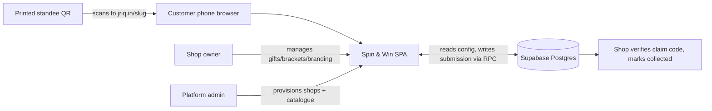

**Files.** `src/types/index.ts` (domain types), `supabase/migrations/` (persistence), `README.md`
(some copy is stale — trust code over docs).

**Execution trace.** Scan → `/{slug}` → `ShopPage` (`src/App.tsx:106-110`) → `CustomerFlow` →
steps WELCOME…THANK_YOU → RPC `submit_customer_entry` writes `submissions`.

**Misconception.** "The wheel decides the prize." It does not. The server draws the prize before
the wheel spins (Module 10). `[Source-code]`

**Failure scenario.** A shop prints standees pointing at a campaign URL, then the slug is renamed —
printed QRs break. The system mitigates: only the platform can rename (`rename_store_slug`), and
QR artefacts are pinned to the canonical host (Module 12). `[Source-code]`

**Exercise.** List every noun in this module that maps to exactly one database table. Which noun
maps to none? *(Answer: "standee" — it is a rendered page, not a table.)*

**Checkpoint.**
1. Which two admin roles exist, and who provisions a shop?
2. Where does "what the customer won" get permanently recorded?
<details><summary>Answer key</summary>

1. Platform admin (`platform_admins`) provisions shops; shop owner (`store_admins`) manages one
   shop. `[Source-code]`
2. In the `submissions` row, as an immutable snapshot (reward + tier + value columns) — not by
   reference alone. `[Source-code]`
</details>

**Recap.** One SPA serves three audiences over one Postgres. Tenants are shops addressed by slug.
The prize decision is a backend fact; the wheel is theatre.

---

## Module 2 — One source, two builds, two hosts

**Concept.** There is a single React source tree but **two deployment targets** with different URL
bases. Vite's `base` decides the asset prefix and the router's basename. GitHub Pages hosts the
project site under `/gift/`; the production domain `jriq.in` hosts at `/`.

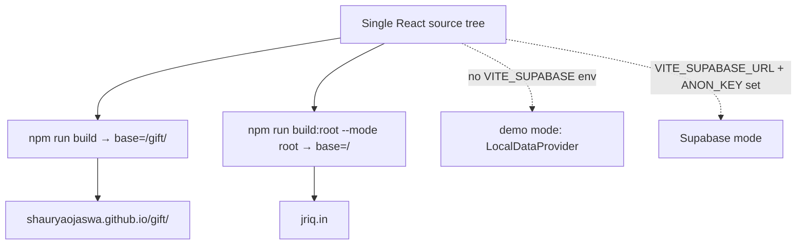

**Files.** `vite.config.ts:5-15` (base logic), `src/main.tsx:10`
(`basename={import.meta.env.BASE_URL…}`), `package.json` scripts (`build`, `build:root`),
`public/.htaccess` (root-domain 301s), `public/404.html` (Pages SPA fallback).

**Execution trace.** `npm run build` → `base='/gift/'` → emitted `index.html` references
`/gift/assets/index-*.js` → Pages serves at `/gift/…`. Same source on jriq.in emits `/assets/…`.
`BASE_URL` flows into `BrowserRouter`, so `/gift/jolly-enterprises` and `/jolly-enterprises` hit
the same route. `[Live-test: both origins render the same app]`

**Misconception.** "Different asset hashes on the two hosts prove different versions." Not
necessarily — changing `base` alone changes bundle content and therefore hashes. Version claims
need behavioural evidence (e.g. a feature/fix present or absent). `[Inference]` — this audit proved
Pages *is* stale by exhibiting a live crash whose fix exists in git.

**Failure scenario.** Someone hard-codes `/assets/…` or a link without respecting `BASE_URL` —
works on jriq.in, breaks on Pages. The project prevents this via `BASE_URL`-derived basename and a
pinned QR host variable (Module 12).

**Exercise.** Open both origins' homepages and compare network logs. What differs, and what does
not? *(Answer: asset base path and hash differ; DOM copy and behaviour match.)*

**Checkpoint.**
1. Which command builds the jriq.in bundle?
2. What does the app fall back to when the Supabase env vars are missing?
<details><summary>Answer key</summary>

1. `npm run build:root` (`tsc -b && vite build --mode root`, `base=/`). `[Source-code]`
2. `LocalDataProvider` — browser-localStorage demo mode, explicitly not a secure deployment.
   `src/lib/data/index.ts:41-50`. `[Source-code]`
</details>

**Recap.** Base path is build-time configuration, not branching logic in the app. Demo mode is an
automatic fallback, not a separate product.

---

## Module 3 — Routing: system routes first, tenant surface last

**Concept.** React Router matches static segments ahead of dynamic ones, and the app leans on that:
every system route is declared before `/:slug`. The tenant surface is intentionally last so a shop
slug can never shadow `/platform`, `/privacy`, etc. Reserved slugs are additionally refused in
`src/lib/slugs.ts` **and** by a DB CHECK. `[Source-code]`

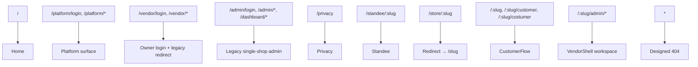

**Files.** `src/App.tsx:46-103` (route table), `src/App.tsx:34-37` (`StoreRedirect`),
`src/lib/slugs.ts` (`isRoutableSlug`, reserved list), `src/features/not-found/NotFound.tsx`.

**Execution trace (verified live).** `jriq.in/store/jolly-enterprises` → `.htaccess` HTTP 301 →
`/jolly-enterprises` → `ShopPage` → `isRoutableSlug('jolly-enterprises')` → `CustomerFlow`.
On Pages the 301 cannot exist (static hosting), so `public/404.html` rewrites the deep link to
`?p=/store/jolly-enterprises` and the SPA restores it. `[Live-test]`

**Misconception.** "The `/{slug}/customer` spelling is an old bug." Both `customer` and the
requested `costumer` spelling intentionally render the same page **without redirect** so the URL a
shop printed stays intact (`App.tsx:87-95`). `[Source-code]`

**Failure scenario.** A shop is created with slug `platform` (or another reserved word): without
guard layers, `jriq.in/platform` would become ambiguous. Prevented twice: `stores_slug_reserved_check`
(DB) and `slugs.ts` (client). `[Source-code]`

**Exercise.** Write the route table as a ranked list and mark which routes are "system" vs
"tenant". Which tenant route is nested, and why? *(`/:slug/admin/*` is nested to share the
VendorShell auth/tenant wall across its pages.)*

**Checkpoint.**
1. What renders for `jriq.in/kohinoor` when that shop exists only in staging data?
2. Which component proves a slug is routable?
<details><summary>Answer key</summary>

1. The designed 404 with "Store \"kohinoor\" not found" — verified live on production. `[Live-test]`
2. `isRoutableSlug` in `src/lib/slugs.ts`, called in `ShopPage` (`App.tsx:108`). `[Source-code]`
</details>

**Recap.** Ordering is the routing strategy; reserved-slug double-gating is the safety net; legacy
paths are preserved by redirect, not deletion.

---

## Module 4 — The customer flow state machine

**Concept.** The customer journey is an explicit finite state machine held in a Zustand store with
sessionStorage persistence. Screens are pure renderers of `step`; transitions are validated against
a `TRANSITIONS` map, so "skip from WELCOME to REWARD" is impossible by construction.

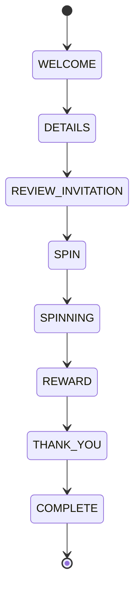

**Files.** `src/features/customer-flow/store.ts` (state + actions + `SESSION_KEY = 'gift:flow'`),
`src/features/customer-flow/CustomerFlow.tsx:20-38` (`StepRenderer` switch),
`src/features/customer-flow/steps/*Screen.tsx`, `src/types/index.ts:1-9` (`FlowState`).

**Execution trace.** `init(slug)` → restore session or seed → START → `setStep('DETAILS')` →
form writes `fullName/purchaseAmount/phoneNumber/consent` → CONTINUE calls the DataProvider
(`DetailsScreen.tsx:118`) and stores `submissionId`, `claimCode`, `rewardResult` →
`REVIEW_INVITATION` → `SPIN` → `SPINNING` (animation) → `REWARD` → `THANK_YOU` → `COMPLETE` +
`clearFlowSession(slug)` (`store.ts:225`). `[Source-code + Live-test of the full journey]`

**Misconception.** "SPINNING means the server is choosing." No — by the time the wheel spins, the
reward is already stored (`setRewardResult` happens at CONTINUE). `SPINNING` is only the animation.
`[Source-code]` — corroboration: `SpinWinScreen.test.tsx:185-252` asserts `createSubmission` is
*not* called again from the spin screen.

**Failure scenario.** Reload mid-flow (customer's browser dies on the review step). Because state
is persisted per slug in sessionStorage, the session restores instead of losing the entry;
`request_id` idempotency protects against double-issuing if the customer repeats the submission.
`[Source-code]`

**Exercise.** Draw the machine and mark the exact edge where a database write happens.
*(Answer: the DETAILS → REVIEW_INVITATION edge, inside CONTINUE.)*

**Checkpoint.**
1. How many states, and which one is terminal?
2. What stops the spin screen from issuing a second reward?
<details><summary>Answer key</summary>

1. Eight (`FlowState`, `types/index.ts:1-9`); `COMPLETE` is terminal. `[Source-code]`
2. The assignment is already saved (`hasSpun`/`submissionId` in the store), and tests assert
   `createSubmission` is not re-called (`SpinWinScreen.test.tsx:185`). `[Source-code]`
</details>

**Recap.** A validated transition table + per-slug persistence + idempotent submission keys make
the flow resumable and non-duplicating.

---

## Module 5 — The domain model (types)

**Concept.** TypeScript types are the shared vocabulary between UI, provider and (mirrored)
database. Learn these six and the codebase reads itself.

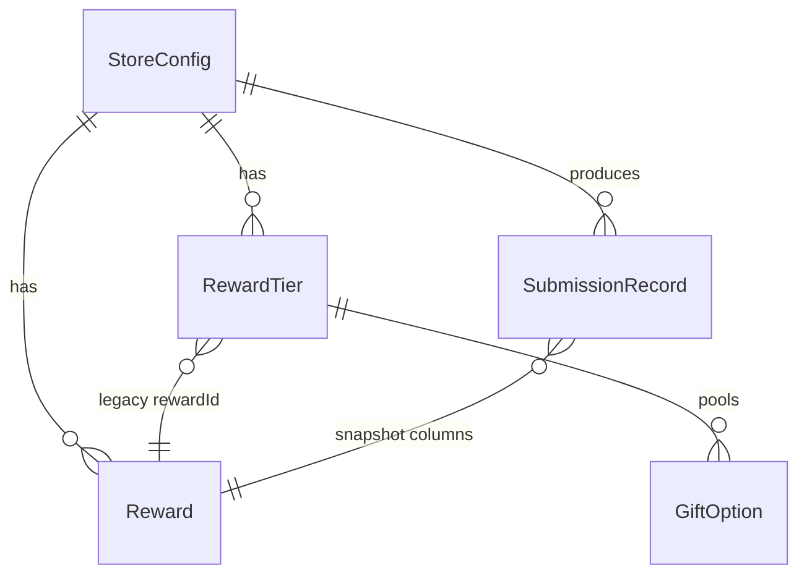

**Files.** `src/types/index.ts` (`FlowState`, `SpinStatus`, `ConsentState`, `Reward`, `GiftOption`,
`RewardTier`, `StoreConfig`, `WheelSegment`), `src/lib/data/types.ts` (`SubmissionRecord`,
`AdminSession`, `AdminStats`, `CreateSubmissionInput`, `RewardAssignment`, `DataProvider`).

**Key shapes.** `[Source-code]`
- `RewardTier.minAmount` inclusive, `maxAmount === null` = open-ended top bracket
  (`reward-engine.ts:11` uses `amount < tier.maxAmount` — half-open ranges).
- `RewardTier.rewardId: string | null` — **null means pool-based bracket**, non-null is the legacy
  single-gift bracket (`types/index.ts:52`).
- `SubmissionRecord` carries a full reward **snapshot** (`rewardLabel`, `rewardVoucherValue`,
  `targetSegment`, …) so history never degrades when the catalogue changes.
- `StoreConfig.reviewLinkOwnerEditable?` — who may edit the Google review link.

**Execution trace.** A store load assembles `StoreConfig` from `stores` + `rewards` +
`reward_tiers` + `get_store_gift_pool` (`supabase.ts:138-202`), then `GiftOption[]` fill each
bracket's pool.

**Misconception.** "`GiftOption.id` is its own table's id." It is the **reward id**
(`types/index.ts:37-38` doc) — pool entries point at `rewards` rows.

**Failure scenario.** Deleting a reward that a past submission references would corrupt history —
the DB forbids it with `ON DELETE RESTRICT` on `submissions.reward_id`. Snapshot columns keep old
rows truthful even when references survive. `[Source-code]`

**Exercise.** Given `minAmount: 500, maxAmount: 2000`, which amounts match? *(Answer: 500–1999.)*

**Checkpoint.**
1. What distinguishes a legacy bracket from a pool bracket?
2. Why snapshot reward fields into `submissions`?
<details><summary>Answer key</summary>

1. `rewardId` non-null (legacy) vs `giftOptions[]` with `rewardId: null` (pool). `[Source-code]`
2. To keep historical claims immutable and honest when catalogue rows later change. `[Source-code]`
</details>

**Recap.** Half-open amount ranges, nullable `rewardId` as a mode switch, and snapshot columns are
the three ideas that explain most domain code.

---

## Module 6 — The DataProvider seam (demo vs Supabase)

**Concept.** All persistence goes through one interface, `DataProvider`. Two implementations exist:
`LocalDataProvider` (browser localStorage; demo/dev only) and `SupabaseDataProvider` (production).
Selection is automatic at startup based on env presence. This is why the whole product can be demoed
with no backend at all — and why "it works in the demo" proves nothing about production.

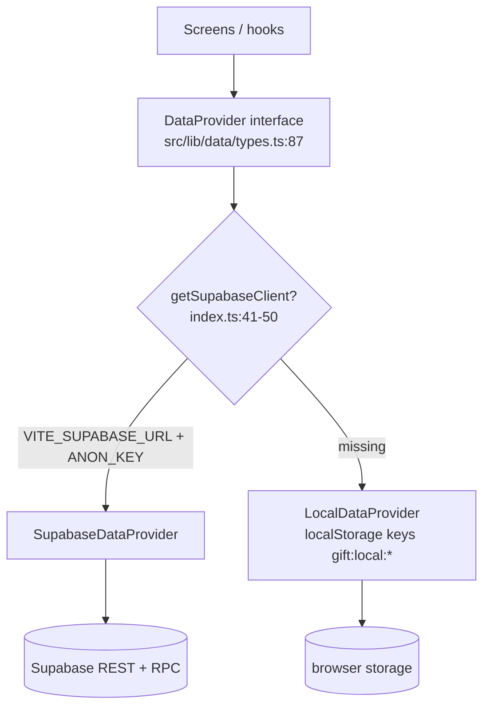

**Files.** `src/lib/data/index.ts` (selection + `getSupabaseClient`), `src/lib/data/types.ts:87-104`
(interface), `src/lib/data/local.ts`, `src/lib/data/supabase.ts`,
`src/providers/DataProviderContext.tsx` (`dataProviderKind`, demo banner message).

**Execution trace.** App boot → `DataProviderProvider` → `getDataProvider()` → later calls like
`createSubmission`, `listSubmissions`, `getStats`, `updateStore`, `uploadStoreLogo` go through the
same interface regardless of backend. `[Source-code]`

**Misconception.** "Demo mode is a mock for tests only." It is a real shipped fallback — if a deploy
loses its env vars, the site silently becomes localStorage-only. The GH Pages workflow comment says
exactly this ("truthfully falls back to LocalDataProvider (demo mode)"). `[Verified fact]`

**Failure scenario.** A deployment without env vars serves a perfectly convincing product that
persists nothing. That is why the app surfaces a banner via `PERSISTENCE_UNAVAILABLE_MESSAGE`
(`DataProviderContext.tsx:46-47`) in Supabase-dependent surfaces. `[Source-code]`

**Exercise.** Which behaviour differs most between providers? *(Answer: reward selection —
`Math.random` client-side in `local.ts:115-121` vs server-side RPC draw in production.)*

**Checkpoint.**
1. Where is the provider chosen?
2. Is localStorage demo mode authenticated?
<details><summary>Answer key</summary>

1. `src/lib/data/index.ts:41-50` (`getDataProvider`). `[Source-code]`
2. No — DEV-only passwordless sign-in (`local.ts:179`), hard-coded single store, explicitly "never
   compiled into production" for the passwordless path. `[Source-code]`
</details>

**Recap.** One interface, two stores, env-driven selection. Any claim about production behaviour
must come from the Supabase path.

---

## Module 7 — The Supabase data path (what one submission really does)

**Concept.** Reads are plain PostgREST selects; **writes to `submissions` are impossible except
through a stored function**. The customer's CONTINUE button calls the RPC `submit_customer_entry`,
which validates, draws the prize, snapshots it, and returns the assignment in one round trip.

```mermaid
sequenceDiagram
  participant D as DetailsScreen
  participant P as SupabaseDataProvider
  participant R as RPC submit_customer_entry (Postgres)
  participant T as submissions / tier_gift_options
  D->>P: createSubmission({...requestId...})
  P->>R: rpc('submit_customer_entry', 7 args)
  R->>R: validate name/amount/phone, campaign active
  R->>R: idempotent replay by (store_id, request_id)?
  R->>R: rate limit 5/hour per phone digest
  R->>R: resolve exactly one bracket
  R->>R: draw: order by random() limit 1 (in-stock pool)
  R->>T: insert submission + snapshot; inc quantity_claimed
  R-->>P: (submission_id, claim_code, reward jsonb, tier jsonb)
  P-->>D: RewardAssignment
  D->>D: setRewardResult → wheel will animate to it
```

**Files.** `src/lib/data/supabase.ts:210-246` (`createSubmission`), `:248-264` (auth),
`:266-329` (`listSubmissions`), `:331-336` (`markSubmissionCollected`), `:338-359` (`getStats`),
`:425-463` (`updateStore`/`uploadStoreLogo`), `:499-508` (`adminStoreId` tenant scoping);
`src/features/customer-flow/steps/DetailsScreen.tsx:118`; migration
`20261017150000_gift_price_policy_and_stock.sql:360-656` (current RPC body).

**Execution trace (read path).** `/{slug}` load → `stores?slug=eq.X&active=eq.true` →
`rewards`/`reward_tiers` by `store_id` → `rpc/get_store_gift_pool`. All four observed live with
HTTP 200 on both origins. `[Live-test]`

**Misconception.** "`listSubmissions` gets stats from an RPC." No — `getStats()` fetches five
columns and aggregates **client-side** (`supabase.ts:338-359`). Fine for dashboards today; a scale
concern later. `[Source-code]`

**Failure scenario.** Network dies after the RPC succeeds but before the response arrives: the
customer retries. Idempotency on `request_id` returns the **same** submission instead of issuing a
second gift (RPC replay branch). A conflicting different payload for the same `request_id` is
rejected. `[Source-code]`

**Exercise.** Trace which function enforces "one bracket only" and what error the customer sees if
zero brackets match. *(Answer: bracket resolution inside `submit_customer_entry`;
"No active reward is configured for this purchase amount".)*

**Checkpoint.**
1. Who can insert into `submissions` directly?
2. What is `adminStoreId()` for?
<details><summary>Answer key</summary>

1. Nobody: INSERT/UPDATE/DELETE is revoked from `anon` and `authenticated`; only the SECURITY
   DEFINER RPC writes. `[Source-code]`
2. It maps the signed-in user → their `store_id` via `store_admins`, scoping every owner query to
   their tenant (`supabase.ts:499-508`). `[Source-code]`
</details>

**Recap.** Reads are REST, writes are RPC, the draw is server-side, and idempotency keys make
retries safe.

---

## Module 8 — Database schema and migrations

**Concept.** The schema is applied by numbered SQL files in filename order. Each file is additive
(DDL + policy tweaks). Learn the four core tables first: `stores` (tenant root), `rewards` (gift
definitions), `reward_tiers` (brackets) and `submissions` (issued claims), plus membership tables
`store_admins` / `platform_admins`.

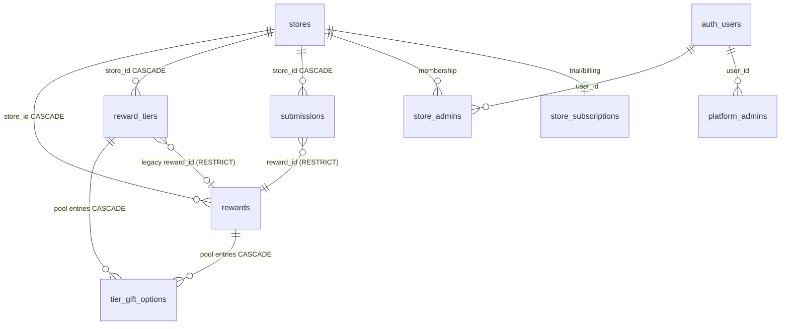

**Files.** `supabase/migrations/20261010202900_initial_schema.sql` (core four),
`20261010203000_managed_tenant_foundation.sql` (membership, subscriptions, rate limits, RLS, helper
fns), `20261015161000/61100/61200` (catalogue, pool, onboarding), `20261016*` (reserved slugs,
addressability, pool display), `20261017120000` (storage policy fix), and the two **uncommitted**
files `20261017150000_gift_price_policy_and_stock.sql` / `20261017150100_shop_config_management.sql`.

**Execution trace.** Migrations run in filename order; e.g. `submissions` gains
`request_id`/`collection_status`/snapshot columns in `20261010203000:6-19`, and
`tier_gift_options` gains `declared_value/quantity/quantity_claimed` in `20261017150000:79-95`.

**Misconception.** "`ON DELETE CASCADE` is always right." Cascades are used within a tenant
(deleting a store clears its children) but `RESTRICT` guards reward references so history can never
point at a deleted gift; actor references use `SET NULL` to keep audit rows. `[Source-code]`

**Failure scenario.** Applying migrations out of order or skipping one yields functions referencing
missing columns (the classic plpgsql lazy-parse error). The project hit and fixed exactly this
class of bug during the uncommitted work (typed column list on `jsonb_each`). `[Source-code context]`

**Exercise.** Which constraint guarantees a customer cannot submit twice for the same scan session?
*(Answer: `unique (store_id, request_id)` on `submissions` + the RPC replay branch.)*

**Checkpoint.**
1. Which table stores the "stock" of a gift?
2. Which FK prevents deleting a reward used by history?
<details><summary>Answer key</summary>

1. `tier_gift_options.quantity` / `quantity_claimed` (uncommitted migration). `[Source-code]`
2. `submissions (store_id, reward_id) → rewards` with `ON DELETE RESTRICT`. `[Source-code]`
</details>

**Recap.** Tenant root + children with tenant-scoped composite FKs, RESTRICT on history, and
migration files as the only schema source of truth.

---

## Module 9 — Security and tenant isolation

**Concept.** Security is layered: (1) **RLS policies** on every table keyed by
`is_store_admin`/`is_platform_admin`; (2) **SECURITY DEFINER RPCs** with `search_path = ''` that
re-verify authority inside the transaction; (3) UI gates that exist for **UX only**. Never trust
the UI layer as the boundary — the code says so explicitly.

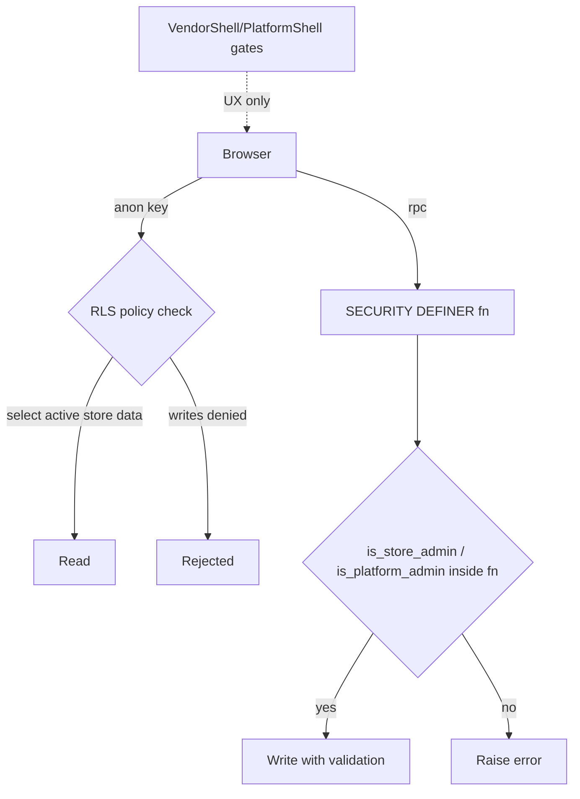

**Files.** `supabase/migrations/20261010203000…:221-359` (RLS + grants),
`20261015170000…` (defence-in-depth revokes), `src/features/vendor/VendorShell.tsx:76-86`,
`src/features/platform/PlatformShell.tsx:14-50`, `src/features/admin/AdminContext.tsx`,
`src/features/platform/api.ts:82-90` (`isPlatformAdmin` client check).

**Execution trace (owner).** Sign in (Supabase Auth `signInWithPassword`) →
`store_admins` lookup (`supabase.ts:501-505`) → every query filtered by `store_id`; visiting
another shop's `/{other}/admin` shows `Forbidden` (`VendorShell.tsx:79-86`) — and even if the UI
were bypassed, `is_store_admin(uuid)` and RLS still refuse. `[Source-code]`

**Misconception.** "The anon key being public is a leak." It is by design — it is the *policies*
that constrain an anonymous caller (read active campaign data, call `submit_customer_entry`,
nothing else). Service-role keys must never ship in `VITE_` vars (README states this). `[Source-code]`

**Failure scenario.** A policy forgotten on one table = public data exposure. Mitigation: RLS is
enabled on **all 15** public tables and `submissions` writes are revoked outright. Another classic:
a `SECURITY DEFINER` fn without `search_path = ''` (search-path hijack) — every fn here sets it.
`[Source-code]`

**Exercise.** Name two independent mechanisms preventing owner A from reading owner B's customers.
*(Answer: `adminStoreId()` query scoping + `is_store_admin` RLS on `submissions`.)*

**Checkpoint.**
1. Can `anon` insert a submission directly into the table?
2. Are the platform UI gates the security boundary?
<details><summary>Answer key</summary>

1. No — table DML revoked from `anon`/`authenticated`; only `submit_customer_entry` writes. `[Source-code]`
2. No — comments in `PlatformShell.tsx:14-17` and `VendorShell.tsx:76-78` state they are UX; RPCs
   and RLS are the boundary. `[Source-code]`
</details>

**Recap.** Public key + strict policies + privileged server functions with internal re-checks =
multi-tenant isolation that survives a malicious client.

---

## Module 10 — Reward fairness and the wheel

**Concept.** Fairness is a backend property; the wheel is presentation. The server draws uniformly
at random from the bracket's pool **excluding exhausted stock**; the client then animates the wheel
so the winning slice lands under the pointer. Two separate modules do this: `reward-engine.ts`
(what can be awarded, where it lives on the wheel) and `wheel-math.ts` (geometry + animation).

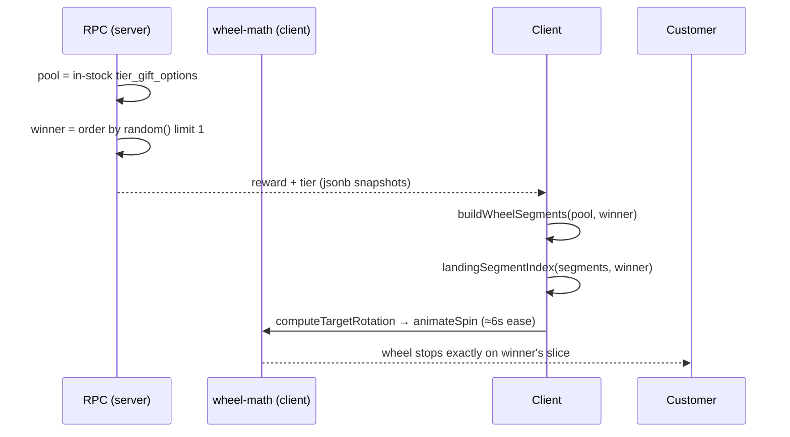

**Files.** `src/lib/reward-engine.ts` (`getPurchaseTier:3-16`, `evaluateReward:82-89`,
`getAwardableOptions:98-115`, `buildWheelSegments:131-162`, `landingSegmentIndex:165-173`),
`src/lib/wheel-math.ts` (`computeTargetRotation:55-73`, `spinEase:84-96`, `animateSpin:104-145`,
`displayLabel:149-217`), RPC draw in `20261017150000…:541-549`.

**Execution trace.** Winner returned → `buildWheelSegments(options, rewardResult)` duplicates pool
gifts across 6/8 slices and marks the saved claim's slice as authoritative (`reward-engine.ts:149-159`)
→ `landingSegmentIndex` finds that slice → `computeTargetRotation` adds 5 full spins + alignment →
`animateSpin` eases over ~6 s. `[Source-code]`

**Misconception.** "Fewer slices = higher chance." Slice count is purely visual
(`reward-engine.ts:137`); probabilities are decided by the uniform draw over the pool in SQL.

**Failure scenario.** Pool runs out of stock mid-campaign: the RPC excludes exhausted options from
the draw and from `get_store_gift_pool` display; if nothing is left the customer sees
"No active reward is configured for this purchase amount" instead of a fake spin. `[Source-code]`

**Exercise.** If a pool has 3 gifts, how many slices does the wheel show and why? *(Answer: 6 —
the `options.length === 3` special case in `buildWheelSegments`, visual balance only.)*

**Checkpoint.**
1. Where is the winning gift actually decided?
2. What happens to `quantity_claimed` when a pool entry is removed?
<details><summary>Answer key</summary>

1. In Postgres, inside `submit_customer_entry` (`order by random() limit 1`). `[Source-code]`
2. Nothing destructive: `save_store_gift_options` soft-deactivates rather than deletes so claimed
   counts survive (`20261017150000:207-213`). `[Source-code]`
</details>

**Recap.** Server draws, client displays; stock and policy constraints live in the draw query, not
in the animation.

---

## Module 11 — Build and test tooling

**Concept.** Four gates keep quality: `tsc -b` (types), `vitest` (behaviour, happy-dom),
`vite build` (bundle), `oxlint` (style). Tests are colocated (`*.test.ts(x)`) and use Testing
Library with real components — including assertions that certain calls do **not** happen.

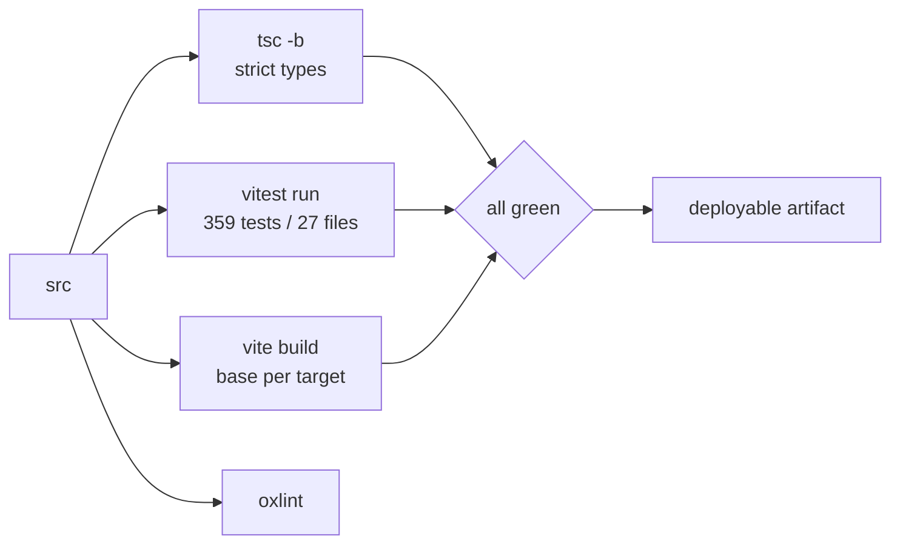

**Files.** `package.json` scripts, `vite.config.ts:16-26` (test config: `happy-dom`, setup file,
coverage v8), `src/vitest.setup.ts`, `src/**/*.test.ts(x)` (27 files).

**Execution trace.** `npm test` → per-file isolated happy-dom environments → component tests mount
real screens with a stubbed provider; `SpinWinScreen.test.tsx` spies `createSubmission` and asserts
it is **not** called again when a saved assignment exists. `[Verified fact: 359/359 executed
2026-10-18]`

**Misconception.** "Green tests mean the deployed site works." Tests prove the code; deployment
drift can still break a live route (Module 12's Pages `/admin/login` crash passed its fix in git
but not in the deployed snapshot). Gates and deploys are separate questions. `[Live-test]`

**Failure scenario.** Environment drift: `@supabase/supabase-js` is a **devDependency** here
(bundled code paths guard its use), so a production install that prunes devDeps before building
would fail the build. The current pipeline runs plain `npm install` — safe today, fragile under a
"production-only install" change. `[Source-code + Inference]`

**Exercise.** Find the test that asserts a non-call. Why is a non-call assertion valuable?
*(Answer: `SpinWinScreen.test.tsx` — it proves the idempotency/no-double-issue property.)*

**Checkpoint.**
1. How many tests pass at audit time?
2. Which command builds the root-domain bundle?
<details><summary>Answer key</summary>

1. 359/359 across 27 files. `[Verified fact]`
2. `npm run build:root`. `[Source-code]`
</details>

**Recap.** Type-check, test, build, lint — and remember each gate proves code, not deployment.

---

## Module 12 — Deployment and operations

**Concept.** Three hosted things exist: production `jriq.in` (Vercel, root base), the GitHub Pages
fallback (`/gift/` base, built by a workflow that lives **on the `gh-pages` branch**), and a stale
Vercel preview. QR artefacts always encode `https://jriq.in/{slug}` via `VITE_PUBLIC_APP_URL`,
regardless of which host served the page.

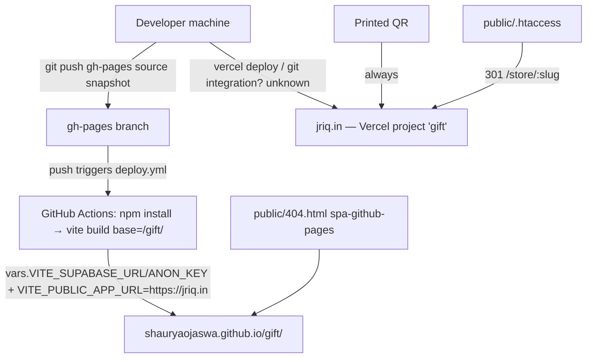

**Files.** `gh-pages:.github/workflows/deploy.yml` (Node 22, `npm run build`, Actions **variables**
for env), `public/404.html` (`pathSegmentsToKeep = 1`), `public/.htaccess`, `vercel.json`,
`.vercel/project.json`, `scripts/preflight.mjs`, `scripts/qa-sweep.mjs`, `scripts/backend-e2e.mjs`
(operational tooling).

**Execution trace of the observed failure (Pages `admin/login`).** Source snapshot refreshed
2026-10-17 08:35 (`22095f4`) → fix `e025b5a` committed 20:33 → Pages never rebuilt → live crash
`useAdminAuth must be used within AdminAuthProvider`, while jriq.in (deployed from ≥ 20:33) renders
fine. Same code, two hosts, different behaviour = deployment drift, not a code bug. `[Live-test +
Verified fact]`

**Misconception.** "Merging to `main` releases." Nothing indicates jriq.in or Pages deploys from
`main`; `staging` is 44 commits ahead of it and the Pages snapshot is pushed manually. Release
paths must be documented before trusting "it's merged". `[Verified fact + Inference]`

**Failure scenario.** Env variables missing in Actions → Pages builds demo mode → the fallback host
silently stops talking to the backend. The workflow comments acknowledge this; monitoring the build
config (or a post-deploy smoke test) is the mitigation. `[Source-code + Recommendation]`

**Exercise.** Using only public evidence, how would you prove which source jriq.in serves?
*(Answer: probe for a behaviour introduced or fixed by a known commit — e.g. the `/admin/login`
crash fix — rather than comparing asset hashes.)*

**Checkpoint.**
1. What triggers the Pages build?
2. Why must QR URLs be pinned to jriq.in?
<details><summary>Answer key</summary>

1. A push to the `gh-pages` branch (or manual `workflow_dispatch`). `[Verified fact]`
2. So a standee printed while a customer was on any host still scans to the canonical, stable
   campaign URL (`VITE_PUBLIC_APP_URL=https://jriq.in` in the workflow). `[Source-code]`
</details>

**Recap.** Deploy sources differ per host; behavioural probes beat hash comparisons; printed QRs
depend on the canonical host constant.

---

## Glossary (quick reference)

| Term | Definition |
|---|---|
| RLS | Row-Level Security — Postgres policies filtering rows per caller role/identity |
| SECURITY DEFINER | Function running with its owner's privileges; must pin `search_path` |
| RPC | Remote Procedure Call — here, PostgREST `POST /rest/v1/rpc/{fn}` |
| Anon key | Public API key shipped to browsers; constrained by RLS, not secret |
| Snapshot columns | Copies of reward facts stored on `submissions` at issue time |
| Idempotency key | `request_id` making retries return the original result |
| Half-open range | `[min, max)` amount matching used by brackets |
| Base path | Vite `base`; URL prefix (`/gift/` vs `/`) |
| SPA fallback | Server/host rewrite of unknown paths to `index.html` |
| Tenant | One shop = one row in `stores` with its own data island |

## Suggested learning path

1. Run `npm run dev` (demo mode) and walk the customer flow with devtools open.
2. Read `src/App.tsx` then `store.ts` — the two spines of the app.
3. Read `submit_customer_entry` in migration `20261017150000` top to bottom; it is the business
   heart of the product.
4. Open one live origin and repeat this audit's checks (Module 12 exercise).
