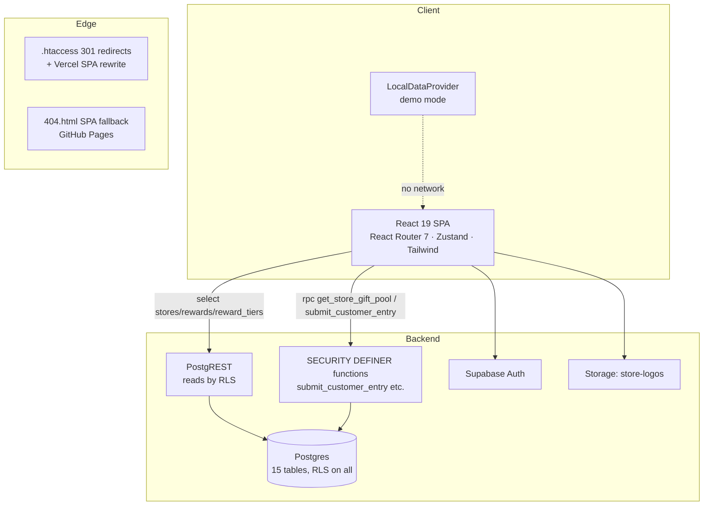
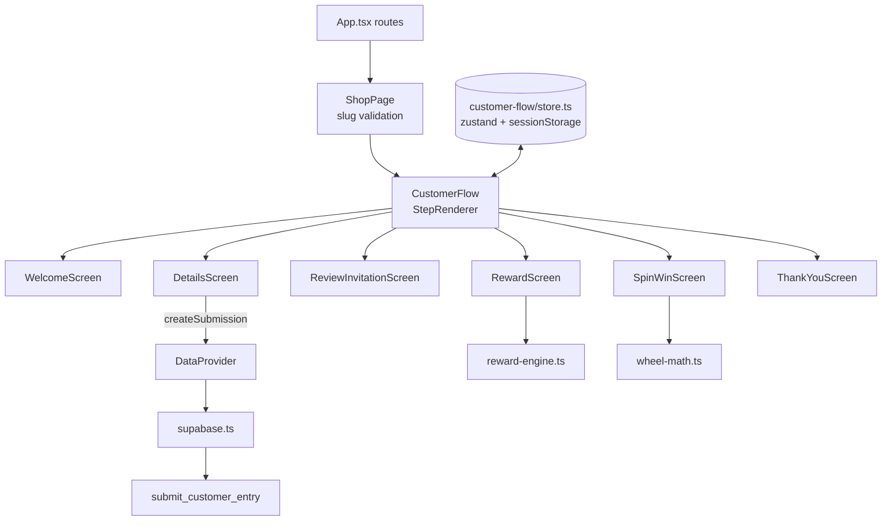

# System design — C4 views and actual-vs-proposed comparison

Audit date: 2026-10-18. Views describe **what exists** (labels: `[Source-code]`, `[Live-test]`,
`[Verified fact]`, `[Inference]`). Anything suggested but absent is in the clearly separated
**Proposals** section and is labelled `[Recommendation]` — never mix the two.

---

## C4 Level 1 — System context

```mermaid
flowchart TD
  C[Customer<br/>phone browser after QR scan] --> SYS[JRIQ Spin & Win<br/>multi-tenant rewards platform]
  O[Shop owner] --> SYS
  P[Platform admin] --> SYS
  SYS --> GA[Google Reviews<br/>review link / QR per shop]
  SYS --> SB[Supabase<br/>Postgres + Auth + Storage]
  S[(Shop counter: printed standee<br/>QR encodes jriq.in/{slug})] -.-> C
  SYS --> V[Vercel hosting jriq.in]
  SYS --> GHP[GitHub Pages fallback host]
```

- Actors verified live: customer flow and standee render publicly `[Live-test]`; owner/platform
  surfaces render behind auth gates `[Live-test]`; Google review CTA exists per shop and disables
  itself without a configured link `[Live-test + Source-code]`.
- Data stores: Supabase (Postgres + Auth + Storage bucket `store-logos`) `[Source-code]`; browser
  localStorage in demo mode only `[Source-code]`.

## C4 Level 2 — Container



- Build containers: two Vite targets (`base=/gift/` for Pages, `base=/` for jriq.in)
  `[Source-code]`; deployment containers differ per host (Module 12 of the tutorial).
- Notable asymmetry: `submissions` has **no** table-level write path; the only writer is
  `submit_customer_entry` `[Source-code]`.

## C4 Level 3 — Component (customer path)



Owner workspace components: `VendorShell` (auth + tenant wall) → `Overview`, `Customers`,
`Rewards`, `Settings`, `QRPage`; platform: `PlatformShell` → `ShopsPage`, `CatalogPage`
(+ uncommitted `ShopConfigPanel`, `GiftPoolPanel` rewrite, `QrDeliverable`) `[Source-code]`.

## C4 Level 4 — Code (the one function that matters most)

`submit_customer_entry` (migration `20261017150000_gift_price_policy_and_stock.sql:360-656`):

```text
validate name (regex/len) → amount (1..1e8) → normalize phone (^[6-9][0-9]{9}$)
→ lock store 'for share', require active campaign
→ idempotent replay? return existing : reject conflicting reuse
→ rate limit 5/hour per (store, phone digest)
→ resolve exactly ONE eligible bracket (else raise "No active reward…")
→ draw: order by random() limit 1 over pool, excluding exhausted stock
→ legacy fallback for pool-less brackets
→ claim_code = prefix + '-' + first-8-hex(request_id)
→ INSERT submissions (snapshot reward + tier + effective value)
→ atomic quantity_claimed increment (only if this call inserted)
→ post-insert verification → return (submission_id, claim_code, reward, tier)
```

Design properties visible in the code: single-transaction decision + write, no client input
influences the draw, retries safe, stock monotonic `[Source-code]`.

---

## Actual vs limitation vs proposal

| # | Area | Actual (evidence) | Limitation of the actual | Proposed change `[Recommendation]` | Why the proposal fits |
|---|---|---|---|---|---|
| 1 | Release path | `jriq.in` (Vercel, source ≥ `e025b5a`), Pages (manual `gh-pages` snapshot + workflow), `main` 44 commits behind `staging` `[Verified fact]` | "Done" ≠ "live"; Pages shipped a crash the code had already fixed `[Live-test]` | Document one release path per origin and converge `staging`/`main`; auto-refresh Pages from the release branch | Removes drift class demonstrated by the `/admin/login` incident |
| 2 | CI | Only `deploy.yml` on `gh-pages` `[Verified fact]` | Tests/build run manually; regressions can land unseen | Add PR/push workflow: `npm test`, `tsc -b`, `npm run build` | The gates already exist as scripts; wiring them costs one YAML file |
| 3 | Stale preview | `gift-alpha-pearl.vercel.app` serves pre-Backend demo build `[Live-test]` | Public URL that looks official but persists nothing | Delete/alias the deployment or add a build-era banner | Prevents customer confusion and brand risk |
| 4 | Working tree | 9 modified + 13 untracked files incl. 2 migrations on no branch `[Verified fact]` | Loss/overwrite risk; schema applied to staging exists only on one machine | Commit to a feature branch after review (no push required) | Cheap insurance; keeps the audit trail honest |
| 5 | Reward fairness | Server-side uniform draw, stock-aware, snapshot on issue `[Source-code]` | Not externally audited; no live production E2E (write ban) `[Unknown]` | Add an ops-run E2E against staging + periodic fairness log/report | Converts "designed fair" into "demonstrably fair" |
| 6 | Stats | `getStats()` fetches columns and aggregates client-side `[Source-code]` | O(n) transfer per dashboard load; races under concurrent use | SQL aggregate RPC keyed by `store_id` | Same interface, server-side truth |
| 7 | Owner onboarding | `create_shop` + invitations + `link_store_owner` (platform-invoked) `[Source-code]` | No self-serve accept-invite surface found `[Unknown]` | Decide operating model; if self-serve, add `/invite/:token` flow | Closes the loop between "invitation row" and "owner can sign in" |
| 8 | Deployed-host behaviour tests | `client-acceptance --base` matrix exists in scripts `[Verified fact]` | Not automated on deploy; runs ad hoc | Run the matrix in CI post-deploy, fail on drift | The tool exists (`7d20873`); the gap is scheduling |
| 9 | Env handling | Actions **variables** feed `VITE_SUPABASE_*`; missing vars silently enable demo mode `[Source-code]` | Silent degradation to localStorage | Post-deploy smoke assert: `dataProviderKind === 'supabase'` | Turns silent fallback into an alert |
| 10 | Documentation | README describes an older product state `[Source-code]` | Onboarding cost; wrong expectations | Refresh README from the route table + this audit | The docs/ folder already has newer material to merge |
| 11 | Phone privacy | Masking is display-level; demo keeps raw numbers `[Source-code]` | Fine for demo; production stores raw phone in `submissions` (needed for ops) | Retention policy + access audit on `submissions` | Privacy page promises retention limits; enforceable in DB jobs |
| 12 | Payments/billing | `store_subscriptions` status columns exist `[Source-code]` | No billing integration found `[Unknown]` | Explicitly scope v1 as manual subscription states | Prevents assuming automated billing exists |

## Deliberately out of scope for the current design

- No microservices: one SPA + one Postgres is the right size for this product `[Inference]`.
- No server-rendered pages: all surfaces are client-rendered; SEO is irrelevant for
  scan-to-campaign flows `[Inference]`.
- The wheel is intentionally client-side theatre over a server decision — keep that split in any
  redesign (it is the fairness guarantee) `[Source-code]`.
